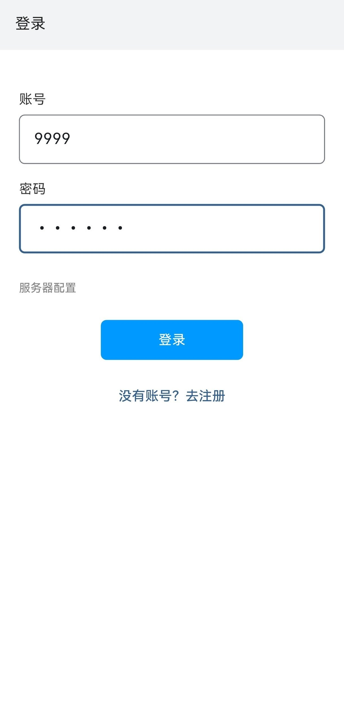
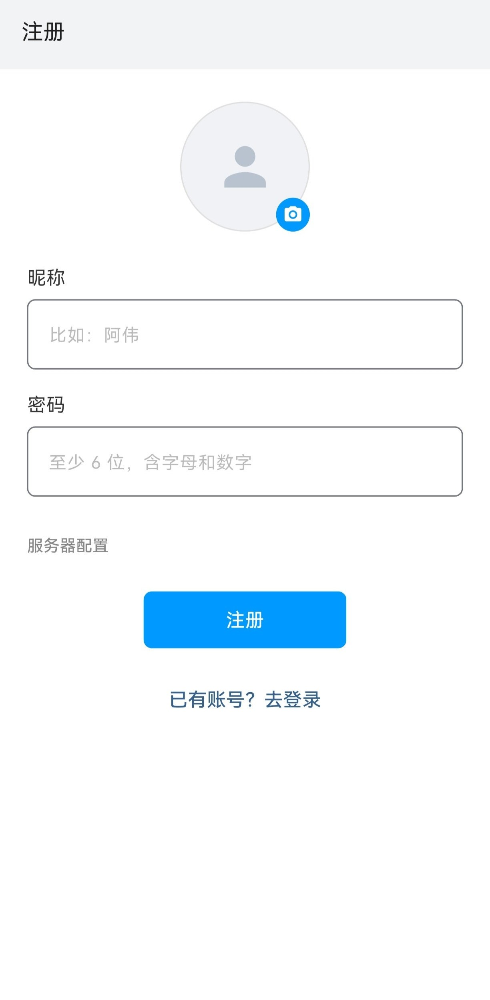

# 极迅 Jixun

面向 Android 的 AI 拟人化聊天框架
Flutter 客户端 + 本地 Python 服务端，WebSocket 长连接

  

## 特性

- **状态驱动**：每个角色维护情绪、能量、亲密度，回复的时机、条数与长度由此计算，对话之间状态连续
- **多段发送**：一次回复拆成多条依次推送，间隔 1~3 秒，可先发半句再补全
- **已读不回**：`ignore` 时消息不发送但状态照常更新，`double_text` 在回复结束后再补一条
- **主动聊天**：静默期间后台评估发起意愿，超过阈值且冷却结束才发送，每日有次数上限
- **人格蒸馏**：上传聊天记录，提取语气、称呼、节奏、作息与关系态度，生成人格档案并持续修正
- **三层记忆**：最近 8~10 轮原文、窗口外摘要、向量检索，支持长期对话
- **群聊**：多个角色各自提交发送意愿分，最高且超过 0.6 者发言，最近发言者扣减 0.35
- **多模型**：对话用主模型，判断用轻量模型，故障切换备用；Key 格式自动识别
- **外观可配置**：软件名、图标、头像、昵称均可修改，不发送系统通知
- **持久化**：延迟队列、待发消息、历史、摘要、人格与向量均落库，重连补发遗漏

## 架构

客户端：界面层、WS 客户端、本地消息队列、打字机引擎、未读管理

服务端：

- 接入层：WS 网关、连接管理、心跳
- 调度层：消息调度、延迟队列、补发管理
- 决策层：状态机、人格管理、记忆、反思循环、群聊、费用控制
- 生成层：API 池、Prompt 组装、Pydantic 解析

## AI 输出协议

模型返回纯 JSON，Pydantic 校验，失败重试一次后按纯文本处理。

```json
{
  "action": "reply | ignore | double_text",
  "delay_seconds": 0,
  "message_count": 3,
  "content": ["消息1", "消息2"],
  "state_update": { "emotion_delta": 0.1, "energy_delta": -0.05, "intimacy_delta": 0.02 }
}
```

## 目录

    src/client      Flutter 客户端（Android / iOS / Windows / macOS / Web）
    src/server      Python 服务端
    screenshots     界面截图
    start.bat       启动服务端
    build_apk.bat   打包 Android APK

## 运行服务端

需要 Python 3.11 或更高版本。

    start.bat

首次运行创建 .venv 并安装依赖，随后打印本机局域网地址，填入 App 的「设置 → 服务器地址」。

## 打包 APK

需要 Flutter SDK、Android SDK、JDK。

    build_apk.bat

产物输出到 dist/apk/，默认仅含 arm64。

## 配置

大模型 API 在 App 内配置：进入任一聊天，右上角设置，填入「API 接口」与「APIKEY」。`sk-` 开头为 DeepSeek / OpenAI 系，`<32位id>.<secret>` 为智谱 GLM。

人格来源：上传聊天记录进行蒸馏，或使用 `src/server/cards/` 下的 YAML 角色卡（`example.yml` 为格式示例）。
